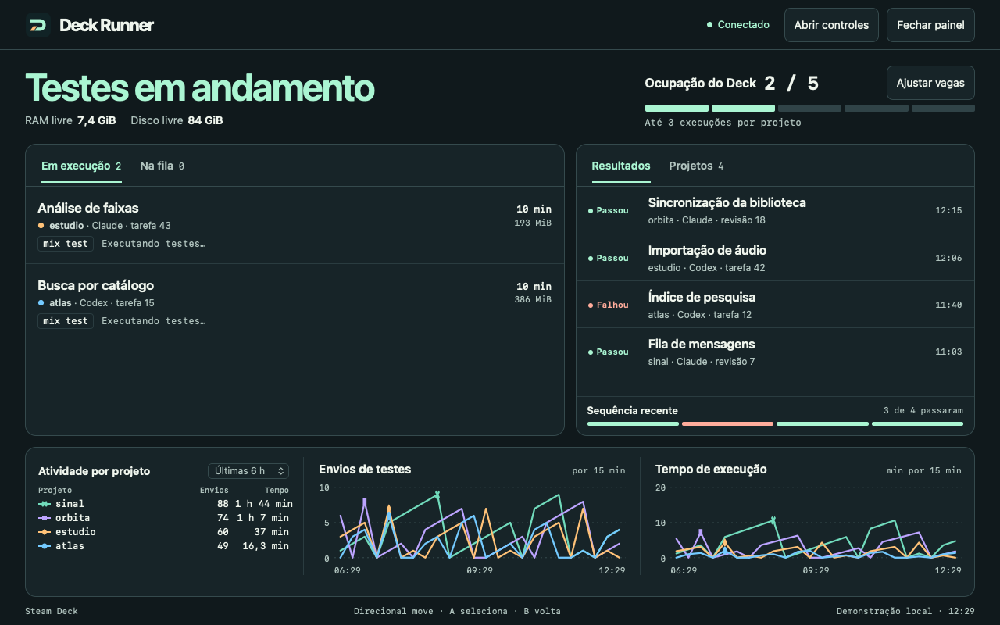

# Deck Runner

Execute os testes de um worktree do Mac em um Steam Deck. O cliente envia um snapshot por SSH, incluindo edições locais. O Deck mantém a fila e o resultado mesmo se o Mac desconectar.

## Envie um teste

Em um projeto já cadastrado, execute estes comandos na sessão e na pasta que contêm as mudanças. O exemplo usa o perfil Mix.

```sh
RUNNER="$HOME/.local/bin/deck-runner"
"$RUNNER" preflight --repo .
```

Com `ready: true`, envie o comando que cobre a alteração. Guarde os campos `id` e `tree` do JSON retornado.

```sh
"$RUNNER" submit --repo . --agent "Codex · tarefa 42" --label "Regras de pagamento" -- mix test
"$RUNNER" wait ID --summary
```

Substitua `ID` pelo identificador recebido. O resumo cabe em uma linha de JSON e traz o projeto, o comando, a árvore testada, o estado, o código de saída e a última contagem reconhecida no log. Relate a contagem quando `test_summary` estiver preenchido. Em caso de falha, o campo `next` indica como ler a saída relevante. [Campos do resultado e códigos de saída](docs/projects.md#contrato-de-execução).

## Validação por sessão e por worktree

- **Preflight bloqueado.** Abra o arquivo indicado em `guide` e procure o valor de `code`. O envio depende do SSH. O painel também é verificado por `doctor`. [Diagnóstico por código](docs/operations.md#decisão-da-frente-antes-do-envio).
- **Outra frente com acesso ao Mac.** Confirme a pasta, o HEAD e as edições locais antes do envio. O caminho padrão usa OpenSSH. Se a equipe já usa Remote Desktop Commander, o PID de `start_process` pertence ao Mac. Leia a saída desse processo para obter o ID do Deck.
- **O envio perdeu a conexão.** Com ID, retome `wait ID --summary`. Sem ID, procure o agente, o projeto e o rótulo em `status --json` antes de reenviar. Depois de editar o código, envie outro snapshot.

## Instale a bancada

Siga o [guia do Deck e do Mac](docs/installation.md). Cadastre a pasta principal uma vez com o perfil, a porta e o usuário de banco do projeto. Após a instalação, abra **Testes no Deck** na Mesa ou os [controles no Mac](http://127.0.0.1:4040/).



## Experimente em um minuto

Para abrir a prévia de leitura com dados fictícios, use Git e Python 3.11+.

```sh
git clone https://github.com/sallaumen/deck-runner.git
cd deck-runner
python3 scripts/preview.py
```

Abra a [prévia local](http://127.0.0.1:4041/?screen=1). Use `--state idle` ou `--state paused` para experimentar outros estados.

| Preciso de… | Guia |
|---|---|
| Perfis Mix, Node, Python e customizados, cadastro e snapshots | [Projetos e agentes](docs/projects.md) |
| Fila, disco, reconexão, Steam Link ou atualização | [Operação e recuperação](docs/operations.md) |
| Estados, isolamento e controles de acesso | [Arquitetura](docs/architecture.md) e [modelo de confiança](SECURITY.md) |
| Testes da bancada e alterações na interface | [Como contribuir](CONTRIBUTING.md), [design](DESIGN.md) e [efeitos da estação](docs/motion.md) |

Distribuído sob a [licença MIT](LICENSE).
