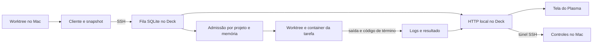

# Da edição ao resultado

## Identidade e isolamento

O cadastro associa o diretório Git comum de um repositório no Mac a um nome e a um perfil. Esse diretório é compartilhado pelas suas worktrees. O cliente calcula a árvore a partir dos arquivos atuais, confere novamente a origem e entrega um bundle com um commit sem pais. O Deck confere o commit e a árvore antes de executar a tarefa. Um resultado identifica o conteúdo aceito mesmo se a branch do Mac avançar depois.

O serviço mantém um repositório Git por projeto, uma referência por tarefa e um worktree descartável. A imagem resolvida fica registrada no resultado. Para Mix, a chave do cache inclui o projeto, a imagem, o lockfile e uma vaga reservada. Duas execuções simultâneas recebem vagas distintas e bancos independentes.

## Transições da fila

| Estado observado | Como acontece |
|---|---|
| Na fila | O upload foi aceito e o registro foi gravado em SQLite. |
| Em execução | Uma transação reserva a vaga e a memória. O tempo exibido inclui a preparação do worktree e das dependências. |
| Passou ou falhou | O processo terminou e o executor registrou o código de saída. |
| Cancelado ou interrompido | Houve um pedido de cancelamento ou o serviço reiniciou com a tarefa em andamento. |
| Expirou ou atingiu limite | O executor encerrou a tarefa por tempo, crescimento do log ou espaço em disco. |

Um observador lê as mudanças de estado confirmadas no SQLite a cada 0,6 s e avisa os painéis conectados por Server-Sent Events. Cada painel busca o estado atual ao receber o aviso ou reconectar. Uma consulta periódica mantém o acompanhamento se o fluxo cair e atualiza memória e logs. O inventário de disco roda separadamente, com uma única medição compartilhada por estação. O Mac pode cair durante uma execução sem retirar sua vaga ou perder o resultado. A identificação da estação, persistida no banco, permite ao diagnóstico confirmar que as conexões SSH e HTTP chegaram ao mesmo Deck.

## Evidência de operação

A publicação foi exercitada com um clone público no Steam Deck, instalação do serviço, build da imagem base e testes da bancada no próprio hardware. Em uma instalação com quatro projetos, o LaunchAgent restabeleceu o túnel após o encerramento do processo SSH e o cliente voltou a encontrar a mesma estação. A validação de interface inclui 1280 × 800, tela de telefone, filtro, consulta de logs, desconexão e recuperação. Os testes reproduzíveis estão em [CONTRIBUTING.md](../CONTRIBUTING.md).
